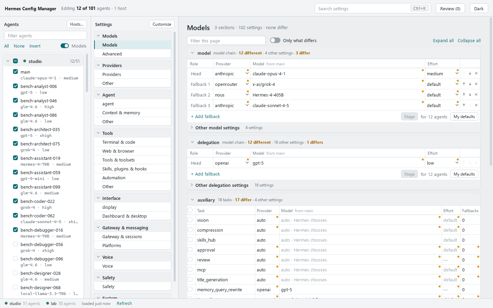
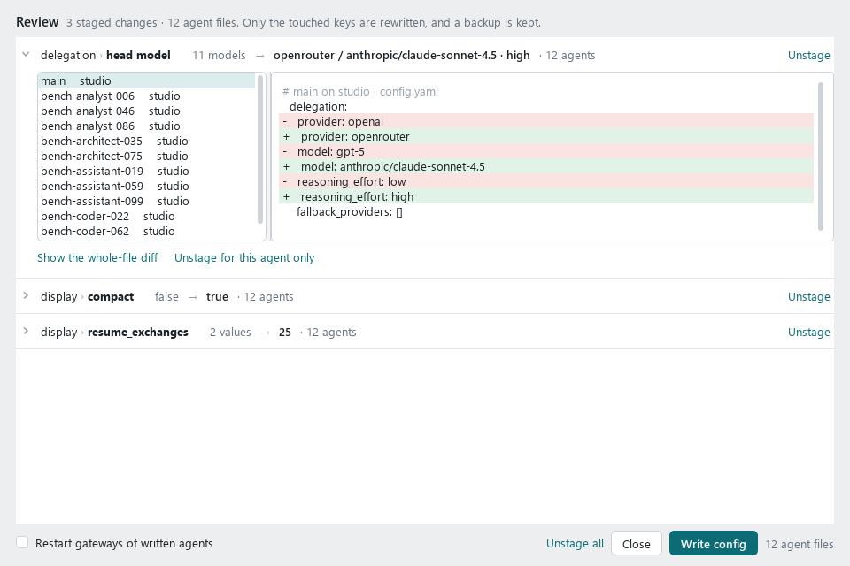
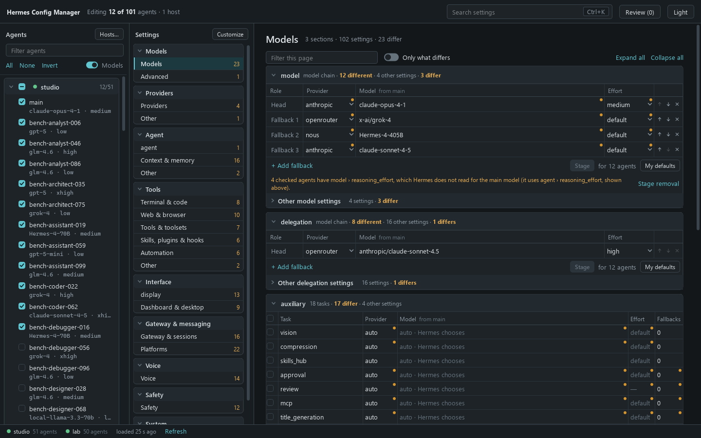

# Hermes Config Manager

A desktop app to view and change any setting of [Hermes Agent](https://hermes-agent.nousresearch.com)
`config.yaml` files — the main config and every `profiles/*/config.yaml` — for many agents on any number
of hosts, in bulk, without rewriting the files.



## Requirements

- Python 3.11 or newer and the packages in `requirements.txt` (PySide6, PyYAML, paramiko).
- For hosts reached over SSH: an SSH key or agent that already logs in to the server, and the OpenSSH
  client (`ssh`) on the PATH for gateway status and restarts.
- **Tested only on Windows 10 with Python 3.14.** Other systems are untested.

## Run it

Install the packages once (`pip install -r requirements.txt`), then double-click
`HermesConfigManager.pyw` (Windows: no console window). A desktop or Start-menu shortcut to it works the same.
`python -m hermes_config_manager` starts it from a terminal.

The first time, the **Hosts** screen opens: add the folder, network share or SSH server where a Hermes
home lives (the folder that holds `config.yaml` and `profiles/`). One host being down never blocks the
others.

## What it changes on your hosts

- **`config.yaml` files**, and only when you press **Write config** in Review. Only the keys you changed are
  rewritten; comments and layout stay.
- **hermes-teammates roster files**, only on hosts that use that optional plugin (`teammates.yaml` next to
  `config.yaml`, see [Teammates](#teammates)), the same way. Removing a profile's own roster file renames it to
  `teammates.yaml.removed-<date-time>`.
- **A backup next to each written file**: `config.yaml.bak_<date-time>`. The app never deletes them.
- **Gateways are restarted only when you ask**: the "Restart gateways of written agents" box in Review
  (off every time Review opens) or Restart in an agent's right-click menu.

Nothing else is written on a host. (Each file is first written to a temporary file in the same folder,
then renamed into place, so a broken connection never leaves a half-written `config.yaml`.)

### Gateways

Gateway status and restart work over SSH and expect Hermes' gateways to run as **systemd user services**
named `hermes-gateway` (the main agent) and `hermes-gateway-<profile>` (each profile), as `systemctl --user`
units. Commands run with `ssh -o BatchMode=yes`: existing keys only, never a password prompt.

### SSH addresses and `~/.ssh/config`

An SSH host's address can be a `Host` alias from `~/.ssh/config`. Its `HostName`, `User`, `Port`,
`IdentityFile` (and `IdentitiesOnly`, `ProxyCommand`) are used for every field left empty on the Hosts
screen; a field you fill in wins. `ProxyJump` works for gateway commands but not for file access.
**Test connection** shows where it connected, e.g. `user@server:22 (from ~/.ssh/config)`.

### SSH server keys

Only servers already in `~/.ssh/known_hosts` are trusted. The first connection to a new server stops and
shows the server's key fingerprint; **Test connection** in Hosts asks whether to trust it, and *Trust and
connect* adds it to `~/.ssh/known_hosts` (the same file `ssh` uses). Compare the fingerprint with the
server's own (`ssh-keygen -lf /etc/ssh/ssh_host_ed25519_key.pub` on the server) before trusting it.


## How it works

The window has three panes: **Agents** (one box per host), **Settings** (categories and their pages) and
the **page** itself.

- **Check the agents** you want to change. Nothing is checked when the app starts. Clicking a name
  focuses that agent: its values fill the page.
- **Edit** any value. An edit stays on the page ("edited, not staged") and does not change when you
  check other agents.
- **Stage** puts the edit, for the agents checked at that moment, in **Review**. You can stage one value
  for some agents and another value for other agents.
- **Review** lists every staged change, grouped by change, with a diff per agent. **Write config**
  writes them all.

Writing only touches the keys that changed (comments and layout are kept). When Review opens, every file
is re-read. If a file changed elsewhere, your edits are applied to the newer file when the settings you
edited were not touched there; if they were, the file is marked and not written until you stage those
settings again. A file that already has your values is marked up to date.
Each written file is backed up (`config.yaml.bak_…`), written and read back to verify. Closing the window
with edits that are not written asks first; an unexpected error is saved (credentials masked) to
`errors.log` in the app's log folder.

### Model chains

Primary model, delegation and every auxiliary task are tables of **provider / model / effort**: the head
and its ordered fallbacks. A small amber dot marks a cell where the checked agents differ (click it to
see who has what). **Stage writes exactly the cells you edited**: changing only the head keeps each
agent's own fallbacks.

The main model's reasoning effort is saved as `agent.reasoning_effort`, which is what Hermes reads
(`model.reasoning_effort` is not used for the main model).

**My defaults** are chains you save yourself (and can edit, import and export); *Use* fills the table.



### Model list

The model picker offers the models in your model list plus the models your agents already use. The list is
`models.md` in the app's settings folder (see below): one model per line, written as `` - `provider: model` ``
(provider and model id exactly as in `config.yaml`); headings and other text are ignored. **Edit list** in the
picker opens it in your text editor (it is created from an example when missing); **Other file…** uses another
file instead, for example one shared with a team. The picker reads the file again each time it opens. Without
a list, the picker uses the model lists of the hosts' own Hermes (`provider_models_cache.json`).

### Teammates

[hermes-teammates](https://github.com/100yenadmin/hermes-teammates) is an **optional, third-party** Hermes
plugin: it is not part of Hermes Agent or of this app, and the app never installs it. You need it only to use
this page; without it everything else works the same and the page only says that no host uses the plugin.

On hosts that have the plugin, **Models › Teammates** edits its rosters. A roster is a YAML file with one
top-level `teammates` mapping, kept next to the agent's `config.yaml` (usually `teammates.yaml`). Which roster
an agent uses is set in its `config.yaml`, under `plugins.entries.hermes-teammates.settings`:

- `roster_file`: the agent's roster file (relative to its folder). A file the agent does not point at is not
  used;
- `roster_source`: `own` (its own roster), `root` (the main agent's) or `fallback` (its own when it has a
  teammate, otherwise the main agent's).

The page shows the roster the agent uses: the main agent edits the master; a profile with its own file edits
that file; a profile that uses the main agent's roster, or keeps its roster in `config.yaml` itself, shows it
read-only. **Replace roster** gives the checked profiles a copy of the master (or of the shown agent's file),
exactly as written, and sets their `roster_file` when it is not set; **Remove own file** sends a profile with
`roster_source: fallback` back to the main agent's roster.

Teammates are edited like the model chains: name, description, route and model (with the model picker),
reasoning effort, toolsets and instructions; `max_live_runs` above the table is each agent's own `config.yaml`
setting. **Stage** puts exactly the edited cells into the rosters of the checked agents; an amber dot shows where
they differ (click it: who has what), and teammates only some of them have are listed with "in k of N". A rename
keeps the teammate's place and comments. The plugin checks each teammate on its own (a bad one is skipped, the
rest still work), so the page marks such teammates and Review refuses a write that would make one unusable.
The plugin reads the roster on every call; a new teammate's name shows in its tools after a gateway restart.
Right-click the table for every action on a cell, a teammate or the whole roster, as on the model chains.

### Arranging the settings

Settings are grouped in categories and pages; sections keep the names and nesting of `config.yaml`.
**Customize** hides, shows and reorders categories, pages, sections and single settings. By default a
setting is shown only when one of your loaded configs contains it ("Show only what my configs use");
"Show everything" lists every setting Hermes knows. Hidden items stay reachable through search (Ctrl+K)
and the "Hidden (n)" lines. **Related settings** repeats settings from other sections on a page.

### More

Right-click an agent or a host for: refresh, view `config.yaml` (credentials masked), save a copy,
open its folder, all models of the agent, logs, gateway status and restart (SSH).

Credentials are never shown or edited in the settings tables.

A dark theme is one click away (top right).



## Where it keeps its data

- Settings, hosts and your defaults: `%APPDATA%\HermesConfigManager` (Windows) or `~/.config/HermesConfigManager`.
- A disposable cache: `%LOCALAPPDATA%\HermesConfigManager\cache` or `~/.cache/HermesConfigManager/cache`.
- `HERMES_CONFIG_MANAGER_HOME` points all of it somewhere else (tests and benchmarks use it).

## Development

```
pip install -r requirements-dev.txt
python -m pytest -q            # offline: temporary copies and generated fixtures only
python -m ruff check .
python bench/bench_ui.py       # speed of the screens with 101 agents (add --real for a visible window)
python bench/shots_gui.py      # screenshots of the screens
python tools/build_schema.py --blank EXPORT.json --runtime META.json --hermes-src ~/.hermes/hermes-agent
                               # maintainers: rebuild data/hermes_schema.json (see the tool's docstring)
python tools/make_synthetic_fixture.py   # regenerate bench/fixtures (generic configs from the Hermes defaults)
```

Test and benchmark data are generated, generic configs (`tests/fixtures`, `bench/fixtures`); no real agent
configuration is in the repository.

`data/hermes_schema.json` is the list of settings Hermes exports (in its order, with defaults) plus
descriptions and allowed values, plus the `discord:` keys Hermes reads without exporting them (found in
the Hermes source by `tools/hermes_source_keys.py`, described in `tools/discord_keys.json`). Keys a config
has that the list does not are shown as well, marked "not in Hermes' settings list"; one that looks like a
misspelled known key is marked "unknown to Hermes", and a note under the table ("Did you mean …?")
stages the move to the right key, shown in Review. Settings Hermes marks as deprecated say so.

## Licence

MIT. See [LICENSE](LICENSE).
